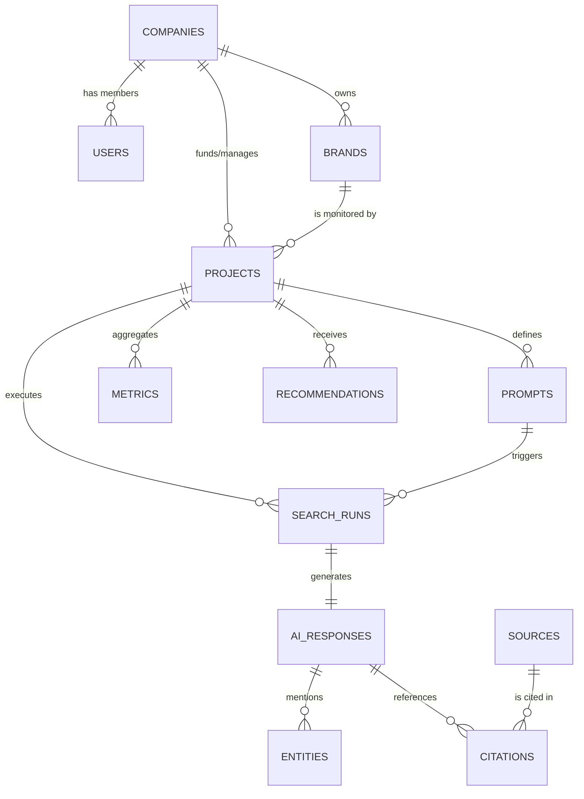

# Database Architecture & Operations Guide

This document outlines the database foundation for the **AI Search Intelligence Platform**, covering technology decisions, table definitions, entity relationships, and Alembic migration workflows.

---

## 1. Why PostgreSQL is Used

PostgreSQL is selected as the primary data store for the AI Search Intelligence Platform for several critical reasons:

1. **Relational Integrity & ACID Compliance**:
   Multi-tenant SaaS architectures require strict referential integrity between organizations, projects, brands, prompts, and runs. Foreign key constraints with `ON DELETE CASCADE` and `ON DELETE SET NULL` prevent orphaned records.
2. **First-Class Semi-Structured Data Support (`JSONB`)**:
   AI engine outputs contain variable metadata (token metrics, latency, parameters, raw payload chunks). PostgreSQL's binary JSON (`JSONB`) allows storing, indexing, and querying unstructured LLM outputs alongside relational entities.
3. **High-Performance Indexing Options**:
   PostgreSQL provides rich indexing capabilities (B-tree, GIN for JSONB, partial indexes, and future GiST/HNSW for vector embeddings), which are vital as the platform scales across millions of search runs and citations.
4. **Future-Proof Vector Search Compatibility**:
   PostgreSQL seamlessly integrates with the `pgvector` extension, allowing future embedding storage and cosine similarity searches without requiring an external vector database.

---

## 2. The 12 Core Tables & Their Purposes

The schema consists of **EXACTLY 12** domain tables:

| # | Table Name | Purpose | Key Fields |
|---|---|---|---|
| 1 | `users` | Application user accounts and access credentials | `id`, `company_id`, `email`, `name`, `password_hash`, timestamps |
| 2 | `companies` | Client organizations/accounts using the platform | `id`, `name`, `website`, timestamps |
| 3 | `brands` | Brands, competitors, or entities being monitored | `id`, `company_id`, `name`, `website`, `description`, `industry`, timestamps |
| 4 | `projects` | Isolated workspaces for AI-search monitoring campaigns | `id`, `company_id`, `brand_id`, `name`, `status`, timestamps |
| 5 | `prompts` | Evaluation queries submitted to AI search engines | `id`, `project_id`, `prompt_text`, `category`, `language`, `region`, `is_active`, timestamps |
| 6 | `search_runs` | Individual executions of a prompt against an engine | `id`, `prompt_id`, `project_id`, `engine`, `model`, `status`, `started_at`, `completed_at`, `error_message`, `created_at` |
| 7 | `ai_responses` | Raw response text and metadata from a search run | `id`, `search_run_id`, `response_text`, `response_metadata` (JSONB), `created_at` |
| 8 | `entities` | Brands, competitors, or products mentioned in AI output | `id`, `ai_response_id`, `entity_name`, `entity_type`, `is_target_brand`, `mention_position`, `context_text`, `created_at` |
| 9 | `sources` | Unique external web URLs cited by AI engines | `id`, `url`, `domain`, `title`, timestamps |
| 10 | `citations` | Mappings connecting AI responses to referenced sources | `id`, `ai_response_id`, `source_id`, `citation_type`, `citation_position`, `cited_text`, `created_at` |
| 11 | `metrics` | Aggregated time-series visibility & sentiment KPIs | `id`, `project_id`, `metric_date`, `visibility_score`, `average_position`, `sentiment_score`, `share_of_voice`, `mention_count`, `created_at` |
| 12 | `recommendations` | AI-generated actionable suggestions for visibility | `id`, `project_id`, `title`, `description`, `recommendation_type`, `priority`, `evidence` (JSONB), `status`, timestamps |

---

## 3. Main Entity Relationships



### Relationship Rules & Foreign Keys:
- **`companies` $\to$ `users`**: One-to-Many (`users.company_id` $\to$ `companies.id`, `ON DELETE SET NULL`).
- **`companies` $\to$ `brands`**: One-to-Many (`brands.company_id` $\to$ `companies.id`, `ON DELETE CASCADE`).
- **`companies` $\to$ `projects`**: One-to-Many (`projects.company_id` $\to$ `companies.id`, `ON DELETE CASCADE`).
- **`brands` $\to$ `projects`**: One-to-Many (`projects.brand_id` $\to$ `brands.id`, `ON DELETE CASCADE`).
- **`projects` $\to$ `prompts`**: One-to-Many (`prompts.project_id` $\to$ `projects.id`, `ON DELETE CASCADE`).
- **`projects` $\to$ `search_runs`**: One-to-Many (`search_runs.project_id` $\to$ `projects.id`, `ON DELETE CASCADE`).
- **`prompts` $\to$ `search_runs`**: One-to-Many (`search_runs.prompt_id` $\to$ `prompts.id`, `ON DELETE CASCADE`).
- **`search_runs` $\to$ `ai_responses`**: One-to-One (`ai_responses.search_run_id` $\to$ `search_runs.id`, `UNIQUE`, `ON DELETE CASCADE`).
- **`ai_responses` $\to$ `entities`**: One-to-Many (`entities.ai_response_id` $\to$ `ai_responses.id`, `ON DELETE CASCADE`).
- **`ai_responses` $\to$ `citations`**: One-to-Many (`citations.ai_response_id` $\to$ `ai_responses.id`, `ON DELETE CASCADE`).
- **`sources` $\to$ `citations`**: One-to-Many (`citations.source_id` $\to$ `sources.id`, `ON DELETE CASCADE`).
- **`projects` $\to$ `metrics`**: One-to-Many (`metrics.project_id` $\to$ `projects.id`, `UNIQUE(project_id, metric_date)`, `ON DELETE CASCADE`).
- **`projects` $\to$ `recommendations`**: One-to-Many (`recommendations.project_id` $\to$ `projects.id`, `ON DELETE CASCADE`).

---

## 4. Migration Guide (Alembic)

All migration commands should be executed from within the `backend/` directory using the project virtual environment.

### 4.1 How to Apply Migrations (Upgrade to Head)

To apply all pending database migrations:

```powershell
# From Sem-7-Project/backend
.\venv\Scripts\alembic.exe upgrade head
```

### 4.2 How to Generate a New Migration (Autogenerate)

After updating SQLAlchemy models in `app/models/`:

```powershell
# From Sem-7-Project/backend
.\venv\Scripts\alembic.exe revision --autogenerate -m "describe_changes_here"
```

### 4.3 How to Rollback the Latest Migration (Downgrade by 1)

To revert the most recent migration step:

```powershell
# From Sem-7-Project/backend
.\venv\Scripts\alembic.exe downgrade -1
```

To rollback all migrations back to base:

```powershell
# From Sem-7-Project/backend
.\venv\Scripts\alembic.exe downgrade base
```

### 4.4 How to Check Current Migration Status

```powershell
# From Sem-7-Project/backend
.\venv\Scripts\alembic.exe current
.\venv\Scripts\alembic.exe history --verbose
```
